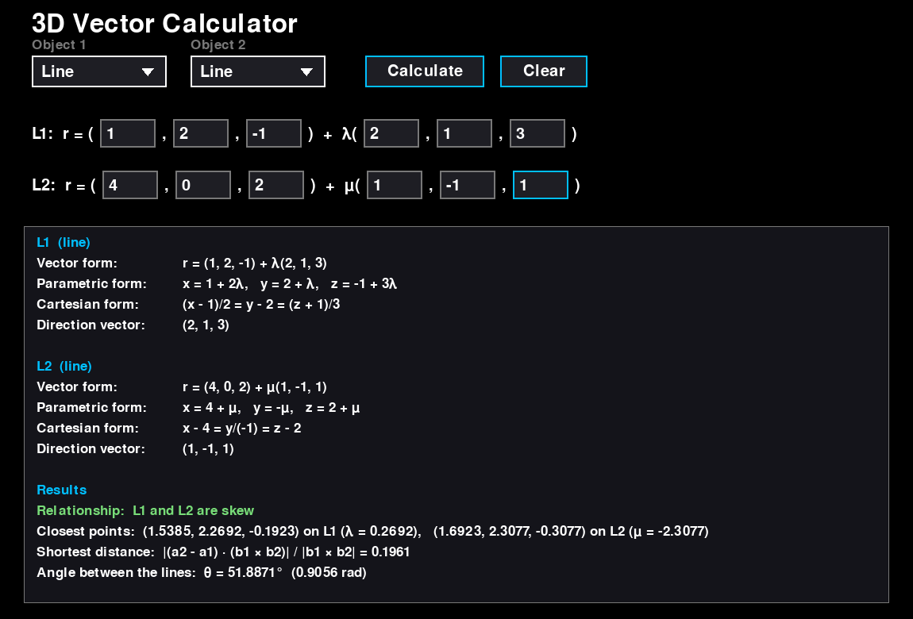
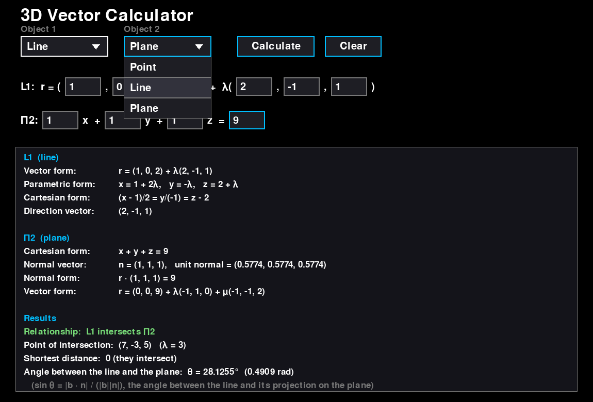
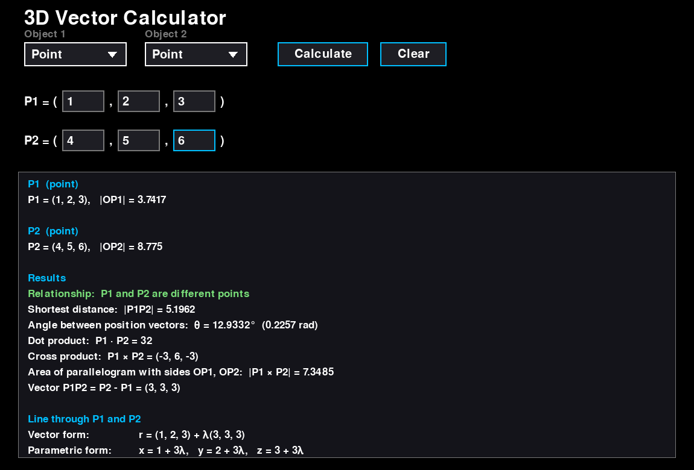
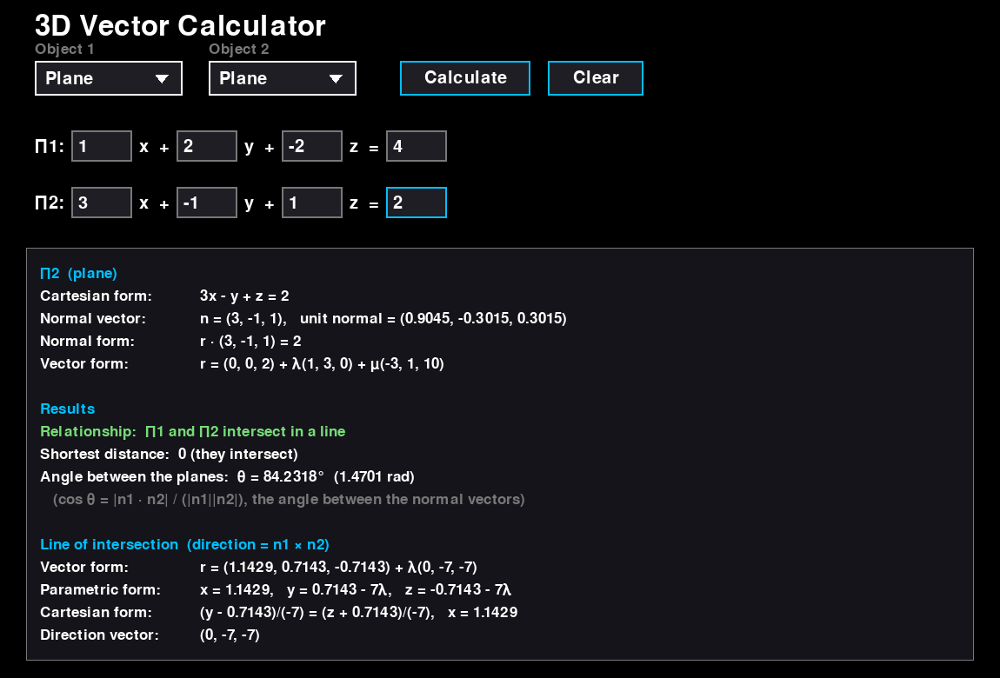

# vector_calculator

> A 3D vector calculator app. Pick two objects (points, lines or planes), type in their equations, and it gives the other forms of each one, the relationship between them, the shortest distance and the angle.



**Part of [phamduylong.com](https://phamduylong.com)** · `type: personal` · `status: finished` · `made: December 2025, IB Math AA HL`

---

## Why I built it

The 3D vectors topic in IB Math AA HL (formula booklet H3.14–H3.17: lines, the vector product and planes) is mostly the same few steps repeated: change a line or a plane into another form, check whether two objects meet, then find a distance or an angle. I built a calculator that does all of these steps at once, so I could check my working on practice questions.


## Before → after

| Before | After |
| --- | --- |
| Working out every form, distance and angle by hand, with no way to check the answer | Choose two objects, type the numbers, and every result appears on one screen |

## What it does

- **Two dropdowns**, *Object 1* and *Object 2*, each with **Point**, **Line** or **Plane**. That covers all six pairs: point–point, point–line, point–plane, line–line, line–plane and plane–plane. The order doesn't matter, so line–point works the same as point–line.
- **The input boxes match how the object is written:**

  | Object | You type | |
  | --- | --- | --- |
  | Point | its x, y, z | `P = (x, y, z)` |
  | Line | its vector equation | `r = (a1, a2, a3) + λ(b1, b2, b3)` |
  | Plane | its Cartesian equation | `Ax + By + Cz = D` |

- **The other forms of every line and plane:**
  - **Line:** vector, parametric (`x = x0 + λl, …`) and Cartesian (`(x - x0)/l = (y - y0)/m = (z - z0)/n`). If a direction component is 0, that coordinate is fixed instead, for example `y = -2`.
  - **Plane:** Cartesian, the **normal vector** and unit normal, the normal form `r · n = a · n`, and the vector form `r = a + λb + μc`.
- **The relationship, the shortest distance and the angle** for every pair:

  | Pair | Relationship | Shortest distance | Angle | Also |
  | --- | --- | --- | --- | --- |
  | Point–point | same point or different | \|PQ\| | between the position vectors | dot product, cross product, parallelogram area \|p × q\|, vector PQ, the line through both points in all three forms |
  | Point–line | on the line or not | \|(p - a) × b\| / \|b\| | not defined | closest point on the line |
  | Point–plane | on the plane or not | \|n · p - D\| / \|n\| | not defined | closest point on the plane |
  | Line–line | **coincide, parallel, intersect or skew** | 0, or the gap between the lines | between the directions (acute) | point of intersection, or the closest point on each skew line |
  | Line–plane | lies in the plane, parallel, or intersects | 0, or the gap if parallel | between the line and the plane | point of intersection |
  | Plane–plane | coincide, parallel, or intersect in a line | 0, or the gap if parallel | between the normals (acute) | the line of intersection in all three forms |

- Angles are shown in **degrees and radians**. Whole numbers are shown without decimals, and everything else is rounded to 4 decimal places.
- It also says when two lines, two planes, or a line and a plane are **perpendicular**.

## How to use it

| Input | Action |
| --- | --- |
| Click a dropdown | Choose Point, Line or Plane |
| Click a box | Type a number. Negatives, decimals and fractions like `1/3` all work |
| Tab / Shift + Tab | Next / previous box |
| Enter or **Calculate** | Show the results |
| **Clear** | Empty every box |
| Mouse wheel | Scroll the results if they don't fit |

If a box is empty, a number can't be read, a line's direction is `(0, 0, 0)` or a plane's A, B and C are all 0, the results panel says what's wrong instead.

<p>
  
  
</p>

## How it works

The app is written in Python. Pygame draws the window and handles the dropdowns, input boxes and buttons. NumPy does the vector maths.

- **Each object becomes a few NumPy vectors.** A point is `p`, a line is `a` and `b` from `r = a + λb`, and a plane is its normal `n = (A, B, C)` and `D`. Each of the six pairs has its own function, and a pair entered the other way round is swapped before it's looked up.
- **Line–line** checks `b1 × b2` first:
  - If it's the zero vector, the lines are parallel. They **coincide** if `(a2 - a1) × b1` is also zero.
  - Otherwise the distance is `|(a2 - a1) · (b1 × b2)| / |b1 × b2|`. If that's 0 they **intersect**, and if not they're **skew**.
  - λ and μ come from solving `a1 + λb1 = a2 + μb2` by least squares (`np.linalg.lstsq`). That gives the intersection point when the lines meet, and the closest pair of points when they're skew.
- **Line–plane** uses `n · b`. If it's 0, the line is parallel to the plane, or lies in it if `a` is on the plane. Otherwise `λ = (D - n · a) / (n · b)` gives the intersection, and the angle is `arcsin(|b · n| / (|b||n|))`.
- **Plane–plane** uses `n1 × n2`:
  - If it's zero, the planes are parallel, with `n2 = k·n1`. They coincide if `D2 = k·D1`.
  - Otherwise the line of intersection has direction `n1 × n2`, and its point is found by solving the two plane equations together with `r · (n1 × n2) = 0`.
- **The other forms are built as text.** For a plane's vector form, the point sets two of x, y, z to 0, and the two directions are `(-B, A, 0)` and `n × (-B, A, 0)`, which are both perpendicular to `n`.
- **The tolerance is 10⁻⁹.** Anything smaller counts as 0, so floating-point rounding doesn't turn "parallel" into "intersect".

## Built with

`Python` · `Pygame` · `NumPy`

## Run it

```bash
git clone https://github.com/pdlong-09/vector_calculator.git
cd vector_calculator
pip install -r requirements.txt
python calculator.py
```

## Files

| File | What it is |
| --- | --- |
| `calculator.py` | The whole app: the vector maths, the other forms, and the Pygame interface |
| `requirements.txt` | Pygame and NumPy |
| `docs/` | Screenshots for this README |


## Limitations

- **Answers are decimals, not exact values.** It shows `0.5774`, not `1/√3`, and it can't take `√2` or `π` as input.
- **The form it gives isn't always the simplest one.** For example, the line through (1, 2, 3) and (4, 5, 6) has direction (3, 3, 3), not (1, 1, 1).
- **It doesn't draw anything in 3D.** The results are text only.
- **It's two objects at a time.** There's nothing for three planes, or for areas and volumes beyond the parallelogram.
- **Points and lines or planes have no angle**, because a point has no direction. The app says "not defined" for those pairs.

<p>
  
  
</p>

> **About the Claude co-author:** Claude was used only to upload these files, which I had already written and stored locally, to GitHub, and to write this README and its supporting files (such as screenshots, `.gitignore` and `requirements.txt`). The code itself is my own work.

---

<sub>Phạm Duy Long · Hà Nội · [phamduylong.com](https://phamduylong.com)</sub>
